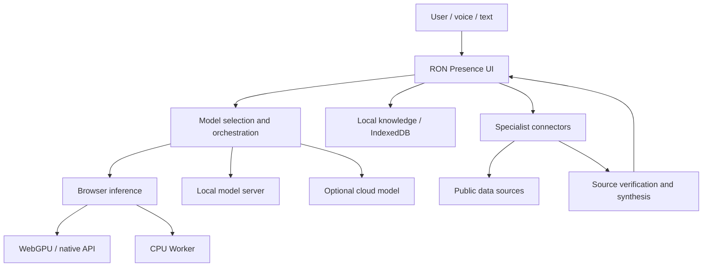

# RON — Edge AI Companion · Studio Niko Design

**A modular French-language AI companion designed around browser inference, local knowledge and explicit network boundaries.**

Un assistant multimodal et agentique qui privilégie les ressources locales, les moteurs légers et les sources explicites.

[](ron-presence.html) [](ron-browser-ai.js) [](ron-presence.html) [](LICENSE.md)

**STUDIO NIKO DESIGN** · Build smart. Stay lightweight. Create without limits.

[RON multimédia](index.html) · [RON Présence](ron-presence.html) · [Guide complet](README-RON-PRESENCE.md) · [English overview](#english-overview) · [Issues](https://github.com/Nikoju1977/Ron-/issues)

> [Insérer ici un GIF de démonstration / Insert demo GIF here]

## Pourquoi ce projet ?

Un assistant personnel ne devrait pas dépendre systématiquement d'un abonnement ou d'un serveur distant. RON sépare le dialogue, le moteur d'inférence, les connecteurs documentaires et la mémoire locale. Le navigateur peut utiliser ses capacités natives ou un modèle téléchargeable ; un serveur local déjà installé ou un fournisseur cloud explicitement choisi reste une option. L'architecture favorise le contrôle des coûts et des flux, sans promettre une qualité identique sur chaque matériel.

## Fonctionnalités clés

- 🧠 **Inférence Edge** : chemins Chrome LanguageModel, WebGPU via WebLLM et CPU via Worker, selon les capacités et les ressources réellement disponibles. Qwen2.5 0.5B, SmolLM2 360M et Gemma 3 270M CPU figurent dans le code de sélection.
- 🔌 **Découverte locale** : détection des endpoints loopback Ollama, LM Studio et vLLM, classement des modèles installés.
- 📚 **Bibliothèque locale** : notes, import de texte et extraits publics, recherche floue Fuse.js, partage de contexte soumis à autorisation.
- 🧩 **Orchestration** : planification, spécialistes, vérification, synthèse ; étapes bornées du hub documentaire. Tous les rôles ne sont pas des processus LLM indépendants.
- 🌐 **Connecteurs** : recherche et informations publiques (notamment météo, Wikipédia, GitHub, publications scientifiques et données alimentaires).
- 🎙️ **Interface multimodale** : dictée et synthèse vocale selon le navigateur, visuels 3D facultatifs, interface PWA.
- 🛡️ **Maîtrise des coûts** : mode gratuit par défaut, limitations d'appels et gestion des erreurs fournisseur ; les quotas, le matériel et la consommation d'énergie restent des contraintes réelles.

## Architecture & sécurité



| Fichier | Responsabilité observée |
| --- | --- |
| [ron-presence.html](ron-presence.html) | Dialogue, configuration, stockage et interface |
| [ron-browser-ai.js](ron-browser-ai.js) | Détection et routage de l'inférence navigateur |
| [ron-auto-config.js](ron-auto-config.js) | Découverte des modèles loopback |
| [ron-knowledge.js](ron-knowledge.js) | Index documentaire et contrôle du partage |
| [ron-agent-hub.js](ron-agent-hub.js) | Planification bornée et vérification des résultats |
| [ron-net.js](ron-net.js) | Connecteurs publics et délais réseau |
| [ron-food.js](ron-food.js) | Calcul glucidique et recherche de données alimentaires |
| [ron-autonomy.js](ron-autonomy.js) | Politique de missions et limites de fréquence |
| [ron-tools/build-pages.cjs](ron-tools/build-pages.cjs) | Construction du périmètre de publication |

**Limites de sécurité et de confidentialité :** IndexedDB n'est pas un coffre chiffré par défaut. Les bibliothèques et modèles peuvent nécessiter un téléchargement initial ; la recherche, les fournisseurs cloud et certaines API vocales utilisent le réseau. La découverte loopback ne garantit ni accès au serveur ni génération réussie (CORS, restrictions du navigateur). Les contrôles de sources ne garantissent pas la véracité de chaque réponse. Le carnet de bien-être et le module alimentaire ne sont pas des dispositifs médicaux validés ; aucune dose d'insuline ni conformité ISO 13485, IEC 62304 ou FDA 21 CFR Part 11 n'est revendiquée.

Dépendances réelles : WebLLM et ressources de modèles pour certains moteurs, Fuse.js, Marked, DOMPurify, Three.js et autres bibliothèques selon l'interface ; jsdom, Playwright et fake-indexeddb pour les tests. Pas de badge « zéro dépendance ».

## Quickstart / Démarrage rapide

```bash
git clone https://github.com/Nikoju1977/Ron-.git
cd Ron-
python3 -m http.server 8000
```

Ouvrir http://localhost:8000/ron-presence.html. Autoriser les téléchargements de modèles uniquement si souhaité, ou configurer un moteur local déjà installé ; vérifier la génération réelle avant de considérer l'installation opérationnelle. L'interface multimédia reste accessible à /index.html. L'installation PWA utilise HTTPS ou localhost. L'utilisation et les modifications restent soumises à la notice de droits existante.

```bash
npm --prefix ron-tests install
npm --prefix ron-tests test
```

La suite est déclarée dans [ron-tests/package.json](ron-tests/package.json). Aucun test de cette suite n'a été réexécuté pour cette mise à jour documentaire ; aucun benchmark, appel LLM ou test de production n'est revendiqué.

## Documentation technique historique et utilisation

Assistant agentique multimodal de Studio Niko Design.

- Interface 3D particulaire
- Accès microphone et reconnaissance vocale
- Architecture multi-LLM / endpoints OpenAI-compatible
- Modes Direct, Agentique et Conseil scientifique
- Déploiement web statique compatible Vercel

Le fichier principal est `index.html`.

## RON Présence

La nouvelle version compagnon est disponible dans [`ron-presence.html`](ron-presence.html) : voix douce, commandes, modes Compagnon/Studio/Analyse et carnet de bien-être volontaire. Elle inclut les éléments d'installation comme application web et une interface responsive.

Consulter [l’utilisation, la compatibilité et les limites](README-RON-PRESENCE.md). Les connexions Samsung Health, Android et Wear OS restent à implémenter. La version multimédia `index.html` est conservée.


## RON gratuit · agents + bibliothèque locale

Accès direct : [RON Présence](ron-presence.html) — également par « IA GRATUITE » dans l'interface principale.

- **Option serveur local** : Ollama sur cet appareil avec Qwen 3.5 4B, sans coût API ni clé, si le modèle est installé. La sélection initiale dépend aussi des capacités du navigateur et de la découverte de moteurs disponibles.
- **Agents** : planificateur, spécialiste, vérificateur pour les tâches complexes, puis synthèse. Les modèles locaux peuvent être plus lents.
- **Protection coût zéro** activée par défaut : seuls les serveurs locaux (Ollama, LM Studio, vLLM, compatible local) et les modèles OpenRouter explicitement gratuits sont autorisés. Une configuration Mistral/Groq ancienne est bloquée tant que la protection reste active.
- **Cloud gratuit en option** : OpenRouter openrouter/free nécessite une clé gratuite et impose des quotas. Aucun compte n'est créé automatiquement.
- **Bibliothèque** : notes et fichiers texte, import explicite de README GitHub publics ou d'extraits de Wikipédia, recherche floue Fuse.js. Rien n'est transmis au LLM sans autorisation.
- **Tests** : exécuter npm --prefix ron-tests install puis npm --prefix ron-tests test.

Voir [installation et limites détaillées](README-RON-PRESENCE.md). Le site statique ne peut installer Ollama sur un ordinateur ni fonctionner comme modèle embarqué autonome sans matériel compatible.


### Configuration intelligente et automatique

Sur une nouvelle installation de RON Présence, la configuration intelligente recherche automatiquement les API de modèles **déjà installées sur localhost uniquement** : Ollama, LM Studio et vLLM. Si un modèle de conversation est détecté, RON choisit l'un des modèles installés en fonction d'une estimation prudente des capacités du navigateur (mémoire disponible annoncée et cœurs), active les agents et sauvegarde uniquement les réglages non secrets. Aucun compte, aucun fournisseur payant, aucune connexion à une machine du réseau local et aucune génération IA ne sont lancés au démarrage.

Un bouton **« Détecter et configurer automatiquement »** permet de relancer ce diagnostic. Les réglages manuels existants sont préservés par défaut ; l'utilisateur peut activer/désactiver les nouveaux scans au démarrage. Si aucun serveur n'est joignable, RON affiche une explication et conserve l'option locale. Les autorisations CORS / réseau privé peuvent limiter la détection sur GitHub Pages. Une vérification effective de la génération passe toujours par « Enregistrer et tester ».

## Publication légère et maintenance

Le site GitHub Pages publie uniquement les fichiers nécessaires aux interfaces `index.html` et `ron-presence.html`, à la PWA et aux bibliothèques exécutées par le navigateur. La liste est maintenue dans `ron-tools/build-pages.cjs` et vérifiée par `ron-tests/public-bundle.cjs`. Les anciennes démonstrations autonomes, les sources de tests et les workflows ne sont **plus exposés sur le site publié**, mais restent disponibles dans l'historique Git et dans le dépôt de développement.

L'installation hors ligne ne télécharge plus obligatoirement Three.js (~600 Ko) : l'ange SVG fonctionne immédiatement, la 3D reste chargée à la demande sur les appareils compatibles. En cas de blocage du stockage IndexedDB, RON garde ses commandes accessibles et peut utiliser temporairement la mémoire ; cela ne garantit alors pas la sauvegarde des réglages ou des notes.

**Limite essentielle :** GitHub Pages ne fournit pas lui-même de serveur d'inférence IA ; le module navigateur peut néanmoins exécuter un modèle compatible après téléchargement des ressources nécessaires. Sur un téléphone, `localhost` vise le téléphone, pas un ordinateur hébergeant Ollama. RON explique l'absence de moteur et propose la configuration gratuite facultative, mais ne peut pas répondre avec un LLM tant qu'aucun moteur navigateur ou serveur n'est accessible.

## Roadmap & contribution

Prochaines étapes proposées, non terminées :

- [ ] Mesurer temps de chargement, débit de génération et mémoire sur CPU/WebGPU, notamment appareils modestes.
- [ ] Tester les moteurs locaux, permissions et restrictions réseau sur appareils physiques.
- [ ] Vérifier les modes hors ligne, mises à jour PWA et restauration de la bibliothèque.
- [ ] Évaluer la provenance des réponses et les limites des connecteurs avec des scénarios reproductibles.

**Première contribution / `good first issue` (label proposé)** : documenter la compatibilité d'un moteur local ou fournir un scénario de reproduction sans données privées. Les retours et rapports de bugs sont bienvenus via les [issues](https://github.com/Nikoju1977/Ron-/issues) ; respecter les droits existants pour les modifications et redistributions.

## English overview

RON is a browser-native companion with optional native/browser inference, WebGPU and CPU paths, local server discovery, public data connectors, local document search and PWA features. Supported model paths depend on browser capabilities, downloads, memory and network permissions. Cloud calls are optional; local-first does not mean entirely offline. The initial model load and actual generation must be verified separately. No fresh runtime tests or benchmarks were conducted for this documentation update.

Quickstart: serve the repository over localhost or HTTPS and open `ron-presence.html`. Configure a compatible model, test generation, and consult [the detailed guide](README-RON-PRESENCE.md). Report reproducible issues without sharing credentials or personal data.

## Licence & auteur / License & author

**© 2026 Studio Niko Design — [Nikoju1977](https://github.com/Nikoju1977).** [Notice de droits / Copyright notice](LICENSE.md) : tous droits réservés pour les contributions originales concernées ; la consultation publique ne confère pas de licence open source. Les bibliothèques et modèles tiers gardent leurs licences propres. Aucune licence n'a été modifiée.
